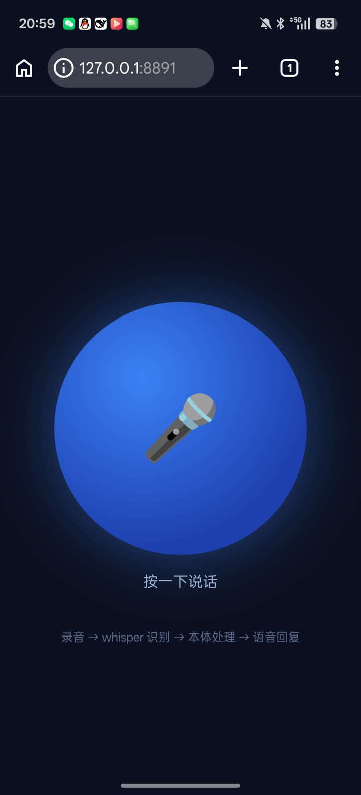

# 手机里的 AI 身体



> 让 AI 住进你的安卓手机，你在 QQ 上跟它说话，它能动手。

不是又一个 QQ 聊天机器人。聊天机器人只会回字，这个能 **看屏幕、点按钮、截图、跑命令、发通知**。

```
你 (QQ)  ──▶  手机里的 AI  ──▶  屏幕 / 文件 / 命令 / 通知
                    │
                    └──▶  顺手回你一句（还是在你那个 QQ 里）
```

## 它和别的手机 QQ 机器人有什么不一样

|  | 普通 QQ 机器人 | 这个 |
|---|---|---|
| 能干的事 | 聊天、发图 | 聊天 + **操作手机** |
| 大脑在哪 | 电脑 / 服务器 | 手机本地 |
| 你不在家时 | 只能聊 | 能替你干活 |

现实场景：你人在外面，QQ 上发一句「帮我看下那台手机的验证码」「把下载文件夹清了」「截图看看现在屏幕上是什么」，手机那头真的会动。

## 怎么搭起来的

```
Linux QQ (proot Ubuntu)
      │
   NapCat           ← QQ 协议端，暴露 OneBot v11（HTTP 3000 / WS 3001）
      │
  bridge.mjs        ← 收消息、转发、去重、语音转文字
      │
  DSH (安卓 App)     ← 大脑 + 手：读屏、点击、文件、命令
      │
  回你一句
```

- **嘴**：QQ 里的 AI 分身，陪聊、接梗、判断这句话是不是活
- **手**：DSH 会话，真去干活
- 中间靠 `wake.json` 叫醒——嘴判断「这是活」，就把活递过去

## 特性

- **免 root**：proot 跑 Ubuntu，Shizuku 给 shell 权限就够
- **免扫码**：Linux QQ 带 `-q 账号` 走快速登录，登录态存在手机里
- **看门狗**：45 秒体检，掉线自动重启，扫码自动把二维码推到相册
- **控制面板**：手机浏览器开 `127.0.0.1:3099`，绿灯看状态，点按钮启动/重启/停止
- **去重 + 退避**：断线重连不会回你两遍
- **语音转文字**：QQ 语音（SILK）直接转，不用你手动点转文字

## 实测

一台安卓手机连续跑 8 天的真实数据（不是估算）：

- 257 次模型调用，686k 输入 token（缓存命中 580k）
- 84 次工具调用：跑命令 65 次、QQ 接口 14 次、叫本体干活 5 次
- 掉线 12 次，重新扫码 26 次——这是早期版本最烦的地方，后来上了快速登录和看门狗，扫码次数降下来了

链路是通的，稳定性还在磨。这些数字来自早期版本，不代表现在，但比空口说「能用」实在。

## 快速开始

```sh
# 1. 拿到 shell 权限（Shizuku 或 root），然后
sh install.sh

# 2. 按提示填 QQ 号 / token / API key
# 3. 等它拉起来
```

装完：

- 面板：手机浏览器开 `http://127.0.0.1:3099`
- 状态：`cat /sdcard/DeepSeekHarness/qq/status.txt`
- 首次登录要扫码，二维码会自动复制到相册

详细步骤见 [docs/INSTALL.md](docs/INSTALL.md)。

## 要求

| 项 | 要求 |
|---|---|
| 系统 | Android 11+ |
| 架构 | arm64 |
| 空间 | ≥ 4GB |
| 权限 | Shizuku（推荐）或 root |

## 平台支持

| 平台 | 能不能用 |
|---|---|
| Android 11+ / arm64 | ✅ 完整 |
| Android 但非 arm64 | ❌ 跑不了 Linux QQ |
| iOS / iPadOS | ❌ 见下面 |
| Windows / macOS / Linux | ⚠️ 只能跑 QQ 协议端那一半 |

**iOS 为什么不行**，三条都绕不过去：

1. 没有 proot，跑不了 Linux 版 QQ 客户端
2. 不允许普通 App 常驻后台，看门狗和桥会被系统挂起
3. 没有 DSH（它是安卓 App），"动手"那一半直接没了

iSH / UTM 这类在 iPhone 上模拟 Linux 的路子，慢且不保活，跑 QQ 客户端不现实。

**iPhone 用户怎么办**：QQ 协议端（NapCat）跑在电脑 / NAS / 服务器上，执行端用一台闲置安卓。iPhone 当遥控器，身体还是安卓。

**HarmonyOS / 华为手机为什么多半不行**：这类系统对 ADB 调试和 Shizuku 激活限制得死，经常拿不到 shell 权限。没有 shell 权限，手机里就跑不了 Linux QQ，只能用无障碍服务在亮屏时操作界面——一熄屏，消息收不到也发不出去。想在这类机器上跑，先确认能拿到 Shizuku，否则别开始。

## 已知限制

- **Shizuku 不是可选项**：手机里跑 Linux QQ 靠的是 shell 进程，它不受 App 冻结机制管。没这一步，普通 App 一熄屏就被系统冻住，收不到也发不出，整套链路直接停摆
- **开机自启做不到**：没 root 没有 init.d，重启手机后要手动再跑一次 `start.sh`
- **电池保活**：`qq` / `proot` / `Xvfb` 是 shell 进程不是 App，加不进系统电池白名单，激进的后台管理会杀
- **首次必须扫码**：之后靠登录态快速登录，登录态失效了还得扫
- **可能要身份验证**：非官方客户端登录，有时会被要求做二次验证（现在常见的是国家网络数字身份验证）。自用下来大约一个月两次，验一次就恢复，不用太担心。这不是 bug，是服务端行为，详见 [DISCLAIMER.md](DISCLAIMER.md)

## 文档

- [安装](docs/INSTALL.md)
- [架构](docs/ARCHITECTURE.md)
- [排错](docs/TROUBLESHOOTING.md)

## 用到的开源项目

- [NapCatQQ](https://github.com/NapNeko/NapCatQQ) — QQ 协议端
- [proot](https://proot-me.github.io/) — 免 root 跑 Linux
- [silk-wasm](https://github.com/andyhu/silk-wasm) — SILK 语音解码
- [DSH](https://github.com/deepseek-ai) — 安卓端 AI 运行环境

## 免责声明

**QQ 账号有被限制或封禁的风险，非官方客户端登录还可能被要求身份验证**，请用小号测试。详情见 [DISCLAIMER.md](DISCLAIMER.md)。

## 许可证

MIT
